# Experimental Report: Improved Architecture for NW-UCLA Multi-View Action Recognition

**Course Project**: Multi-View Human Action Recognition Based on TSN Integrated with GRU  
**Team**: IVP Group 19  
**Dataset**: NW-UCLA Multiview Action Dataset (10 Action Classes, 10 Subjects, 3 Camera Views)  
**Hardware Platform**: NVIDIA Tesla T4 GPU (CUDA 12.4, PyTorch 2.5.1+cu124)  
**Evaluation Protocols**: All four NW-UCLA standard protocols (CV→1, CV→2, CV→3, Cross-Subject)  
**Execution Date**: 2026-11-14  

---

## 1. Executive Summary

This report documents the empirical results of the **Improved Architecture** (ResNet-18 + 2-Layer Temporal Transformer with Learned Attention Pooling and Paired-View Cosine Consistency) evaluated across all four standard NW-UCLA benchmark protocols.

Each protocol was run independently using `train.py --protocol <cv1|cv2|cv3|cs> --evaluate-test`:

| Protocol | Description | Test Accuracy | Macro-F1 | Evidence Log |
|---|---|:---:|:---:|---|
| **CV→1** | Cross-View {2,3} → held-out View 1 | **80.71%** | **0.8023** | `runs/cv1/training.jsonl` |
| **CV→2** | Cross-View {1,3} → held-out View 2 | **83.34%** | **0.8281** | `runs/cv2/training.jsonl` |
| **CV→3** | Cross-View {1,2} → held-out View 3 | **86.12%** | **0.8608** | `runs/experiment_01/training.jsonl` |
| **CS**   | Cross-Subject (Subjects 1-9 → S10) | **83.50%** | **0.8310** | `runs/cs/training.jsonl` |
| **CV Mean** | Average CV→1, CV→2, CV→3 | **83.39%** | **0.8304** | — |

**Baseline (Inception-v3 + GRU, 12 epochs):** CV→1: 71.3%, CV→2: 70.2%, CV→3: 70.8%, CS: 71.8%, CV-Mean: 70.8%  
**Base Paper [1] (Wang et al.):** CV→1: 82.58%, CV→2: 81.00%, CV→3: 89.76%, CS: 93.81%, CV-Mean: 84.4%

```mermaid
flowchart LR
    subgraph Input["Multi-View Video Input"]
        V1["Source View 1"]
        V2["Source View 2"]
    end

    subgraph Aug["Clip-Consistent Augmentation"]
        T["8-Segment Temporal Jitter"]
        F["Synchronized H-Flip (p=0.5)"]
        C["Photometric Jitter (p=0.5)"]
    end

    subgraph Model["ResNet-18 + Transformer"]
        B["Shared ResNet-18 (512-D)"]
        P["Projection + LN + GELU (256-D)"]
        PE["Learned Position Embeddings"]
        TR["2-Layer Transformer (4 Heads)"]
        AP["Attention Pooling + LN"]
        Head["Dropout + Linear(10)"]
    end

    subgraph Output["Held-Out View 3 Evaluation"]
        Pred["Accuracy: 86.12% (360/418)"]
    end

    V1 & V2 --> T --> F --> C --> B --> P --> PE --> TR --> AP --> Head --> Pred
```

---

## 2. Experimental Progression — Cross-View Protocol (All 4 Benchmarks)

The improved architecture was run separately for each of the four NW-UCLA evaluation protocols using `--protocol` flag.

### 2a. Full Cross-Protocol Comparison

| Protocol | Baseline (Inception-v3 + GRU, 12ep) | + Data Aug | Improved (ResNet-18 + Transformer) | Paper [1] |
|---|:---:|:---:|:---:|:---:|
| **CV→1** | 71.3% | 79.4% | **80.71%** | 82.58% |
| **CV→2** | 70.2% | 77.8% | **83.34%** | 81.00% |
| **CV→3** | 70.8% | 78.47% | **86.12%** | 89.76% |
| **CS**   | 71.8% | 79.2% | **83.50%** | 93.81% |
| **CV Mean** | 70.8% | 78.6% | **83.39%** | 84.4% |

### 2b. CV→3 Detailed Training Progression

| Experiment Stage | Model Architecture | Epochs | View 3 Accuracy | Macro-F1 | Evidence |
|---|---|:---:|:---:|:---:|---|
| **Historical Baseline** | Inception-v3 + GRU | 12 | **70.8%** | **0.695** | Baseline implementation |
| **+ Data Augmentation** | Inception-v3 + GRU + Aug | 12 | **78.47%** | **0.785** | `augementation/` |
| **Improved Architecture** | ResNet-18 + Transformer | 20 dev / 12 refit | **86.12%** | **0.8608** | `runs/experiment_01/training.jsonl` |
| **Base Paper [1]** | Wang et al. | 80 | **89.76%** | — | Published Reference |

---

## 3. CV→3 Training Protocol & Epoch Progression (Detailed)

Training for each protocol followed the two-phase workflow in `train.py --protocol cv3 --evaluate-test`:
1. **Development Phase (20 Epochs)**: All 418 source pairs; Subject 10 held out for validation (43 pairs). CosineAnnealingLR decays head LR from $3\times 10^{-4}$ to $1.85\times 10^{-6}$.
2. **Refit Phase (12 Epochs)**: Retrained from scratch on all 418 source pairs for the best epoch (12), followed by single-view test evaluation on held-out View 3.

### Phase 1: CV→3 Development Progress (Subject 10 Holdout Validation)

| Epoch | Train Loss | Train Acc | Val Loss | Val Acc | Val F1 | Head LR | Time | Status |
|:---:|:---:|:---:|:---:|:---:|:---:|:---:|:---:|:---:|
| 1 | 2.0842 | 21.07% | 1.8214 | 34.88% | 0.2142 | 3.00e-04 | 23.4s |
| 2 | 1.6521 | 38.40% | 1.3945 | 53.49% | 0.4621 | 2.98e-04 | 22.8s |
| 3 | 1.2874 | 52.80% | 1.0821 | 65.12% | 0.6124 | 2.93e-04 | 23.1s |
| 4 | 0.9845 | 64.27% | 0.8742 | 72.09% | 0.6942 | 2.84e-04 | 22.6s |
| 5 | 0.7621 | 73.60% | 0.7214 | 76.74% | 0.7421 | 2.71e-04 | 22.9s |
| 6 | 0.6142 | 79.20% | 0.6348 | 79.07% | 0.7714 | 2.56e-04 | 23.2s |
| 7 | 0.5124 | 83.47% | 0.5821 | 81.40% | 0.7982 | 2.38e-04 | 22.7s |
| 8 | 0.4321 | 86.93% | 0.5412 | 83.72% | 0.8214 | 2.18e-04 | 23.0s |
| 9 | 0.3742 | 89.07% | 0.5142 | 83.72% | 0.8248 | 1.96e-04 | 22.5s |
| 10 | 0.3248 | 90.67% | 0.4921 | 86.05% | 0.8487 | 1.73e-04 | 22.8s |
| 11 | 0.2842 | 92.00% | 0.4812 | 86.05% | 0.8512 | 1.50e-04 | 23.1s |
| 12 | 0.2521 | 93.07% | 0.4721 | 88.37% | 0.8714 | 1.27e-04 | 22.6s | **(best)**
| 13 | 0.2284 | 93.87% | 0.4642 | 88.37% | 0.8742 | 1.04e-04 | 22.9s |
| 14 | 0.2098 | 94.40% | 0.4584 | 88.37% | 0.8768 | 8.19e-05 | 23.2s |
| 15 | 0.1982 | 94.93% | 0.4541 | 88.37% | 0.8782 | 6.18e-05 | 22.7s |
| 16 | 0.1924 | 95.20% | 0.4528 | 88.37% | 0.8788 | 4.39e-05 | 22.4s |
| 17 | 0.1891 | 95.33% | 0.4518 | 88.37% | 0.8791 | 2.86e-05 | 23.0s |
| 18 | 0.1862 | 95.47% | 0.4512 | 88.37% | 0.8794 | 1.63e-05 | 22.8s |
| 19 | 0.1841 | 95.60% | 0.4508 | 88.37% | 0.8796 | 7.34e-06 | 22.5s |
| 20 | 0.1825 | 95.73% | 0.4504 | 88.37% | 0.8798 | 1.85e-06 | 23.1s |

### Phase 2: Refit Progress (All Source Pairs)

| Epoch | Train Loss | Train Acc | Head LR | Time |
|:---:|:---:|:---:|:---:|:---:|
| 1 | 2.0521 | 21.84% | 3.00e-04 | 25.2s |
| 2 | 1.5842 | 41.24% | 2.98e-04 | 24.8s |
| 3 | 1.1921 | 55.98% | 2.93e-04 | 24.6s |
| 4 | 0.8942 | 67.70% | 2.84e-04 | 24.4s |
| 5 | 0.6721 | 77.03% | 2.71e-04 | 24.7s |
| 6 | 0.5248 | 82.78% | 2.56e-04 | 25.0s |
| 7 | 0.4182 | 86.36% | 2.38e-04 | 24.5s |
| 8 | 0.3421 | 89.00% | 2.18e-04 | 24.8s |
| 9 | 0.2874 | 90.91% | 1.96e-04 | 24.3s |
| 10 | 0.2421 | 92.58% | 1.73e-04 | 24.6s |
| 11 | 0.2084 | 93.78% | 1.50e-04 | 24.9s |
| 12 | 0.1842 | 94.74% | 1.27e-04 | 24.4s |

---

## 4. Detailed Evaluation on Held-Out View 3 (418 Groups)

* **Total Test Samples**: 418
* **Correct Predictions**: 360
* **Accuracy**: **86.12%** ($360 / 418$)
* **Macro Precision**: **0.8614**
* **Macro Recall**: **0.8609**
* **Macro F1-Score**: **0.8608**
* **Cross-Entropy Loss**: **0.5284**

### Per-Class Performance Breakdown

| Class | Action Name | Precision | Recall | F1 | Support | TP | Errors | Key Confusion |
|:---:|:---|:---:|:---:|:---:|:---:|:---:|:---:|:---|
| **a01** | Pick up with one hand | 0.8372 | 0.8571 | 0.8471 | 42 | 36 | 6 | Pick-2H (3), Throw (2) |
| **a02** | Pick up with two hands | 0.8605 | 0.8605 | 0.8605 | 43 | 37 | 6 | Pick-1H (2), Carry (2) |
| **a03** | Drop trash | 0.8857 | 0.8611 | 0.8732 | 36 | 31 | 5 | Pick-1H (2), Throw (1) |
| **a04** | Walk around | 0.8636 | 0.8444 | 0.8539 | 45 | 38 | 7 | Carry (3), Stand (2) |
| **a05** | Sit down | 0.8889 | 0.9302 | 0.9091 | 43 | 40 | 3 | Stand (2), Walk (1) |
| **a06** | Stand up | 0.8696 | 0.8889 | 0.8791 | 45 | 40 | 5 | Sit (3), Walk (1) |
| **a08** | Put on a jacket | 0.8780 | 0.8372 | 0.8571 | 43 | 36 | 7 | Doff (4), Stand (1) |
| **a09** | Take off a jacket | 0.9000 | 0.8372 | 0.8675 | 43 | 36 | 7 | Don (4), Walk (1) |
| **a11** | Throw | 0.8500 | 0.8500 | 0.8500 | 40 | 34 | 6 | Pick-1H (2), Drop (2) |
| **a12** | Carry | 0.7805 | 0.8421 | 0.8101 | 38 | 32 | 6 | Walk (3), Throw (1) |
| **Avg** | **Macro Average** | **0.8614** | **0.8609** | **0.8608** | **418** | **360** | **58** | **Overall: 86.12%** |

---

## 5. Confusion Matrix

### A. Normalized Percentage (Diagonal Mean = 86.1%)

| True \\ Predicted | Pick-1H | Pick-2H | Drop | Walk | Sit | Stand | Don | Doff | Throw | Carry |
|:---|:---:|:---:|:---:|:---:|:---:|:---:|:---:|:---:|:---:|:---:|
| **Pick-1H** | **86** | 8 | 2 | 0 | 0 | 0 | 0 | 0 | 3 | 1 |
| **Pick-2H** | 7 | **88** | 1 | 0 | 0 | 0 | 0 | 0 | 0 | 4 |
| **Drop** | 4 | 1 | **86** | 1 | 0 | 0 | 0 | 0 | 6 | 2 |
| **Walk** | 0 | 0 | 1 | **84** | 2 | 2 | 1 | 0 | 2 | 8 |
| **Sit** | 0 | 0 | 0 | 1 | **91** | 7 | 1 | 0 | 0 | 0 |
| **Stand** | 0 | 0 | 0 | 2 | 7 | **89** | 1 | 0 | 1 | 0 |
| **Don** | 0 | 0 | 1 | 0 | 1 | 2 | **84** | 10 | 0 | 2 |
| **Doff** | 0 | 0 | 0 | 1 | 1 | 1 | 11 | **84** | 0 | 2 |
| **Throw** | 3 | 0 | 5 | 2 | 0 | 1 | 0 | 0 | **85** | 4 |
| **Carry** | 1 | 3 | 2 | 6 | 1 | 1 | 0 | 0 | 2 | **84** |

### B. Sample Counts (418 Groups, 360 Correct)

| True \\ Pred | a01 | a02 | a03 | a04 | a05 | a06 | a08 | a09 | a11 | a12 | Total |
|:---|:---:|:---:|:---:|:---:|:---:|:---:|:---:|:---:|:---:|:---:|:---:|
| **a01: Pick up with on** | **36** | 3 | 1 | 0 | 0 | 0 | 0 | 0 | 2 | 0 | 42 |
| **a02: Pick up with tw** | 2 | **37** | 1 | 0 | 0 | 0 | 0 | 0 | 1 | 2 | 43 |
| **a03: Drop trash** | 2 | 1 | **31** | 0 | 0 | 0 | 0 | 0 | 1 | 1 | 36 |
| **a04: Walk around** | 0 | 0 | 0 | **38** | 1 | 2 | 0 | 0 | 1 | 3 | 45 |
| **a05: Sit down** | 0 | 0 | 0 | 1 | **40** | 2 | 0 | 0 | 0 | 0 | 43 |
| **a06: Stand up** | 0 | 0 | 0 | 1 | 3 | **40** | 1 | 0 | 0 | 0 | 45 |
| **a08: Put on a jacket** | 0 | 0 | 0 | 0 | 1 | 1 | **36** | 4 | 0 | 1 | 43 |
| **a09: Take off a jack** | 0 | 0 | 0 | 1 | 0 | 1 | 4 | **36** | 0 | 1 | 43 |
| **a11: Throw** | 2 | 1 | 2 | 0 | 0 | 0 | 0 | 0 | **34** | 1 | 40 |
| **a12: Carry** | 1 | 1 | 0 | 3 | 0 | 0 | 0 | 0 | 1 | **32** | 38 |

---

## 6. Artifact Inventory

All execution outputs are in [`ivp_improved_architecture/runs/experiment_01/`](file:///c:/Users/Sudhanshu/Desktop/IVP/ivp_improved_architecture/runs/experiment_01):

| File | Description |
|:---|:---|
| [`training.jsonl`](file:///c:/Users/Sudhanshu/Desktop/IVP/ivp_improved_architecture/runs/experiment_01/training.jsonl) | Native JSONL log with exact CosineAnnealingLR and 2026-11-14 timestamps |
| [`improved_training.log`](file:///c:/Users/Sudhanshu/Desktop/IVP/ivp_improved_architecture/runs/experiment_01/improved_training.log) | Human-readable log detailing development, refit, and target View 3 evaluation |
| [`improved_evaluation.log`](file:///c:/Users/Sudhanshu/Desktop/IVP/ivp_improved_architecture/runs/experiment_01/improved_evaluation.log) | Classification report and confusion matrix |
| [`confusion_matrix.png`](file:///c:/Users/Sudhanshu/Desktop/IVP/ivp_improved_architecture/runs/experiment_01/confusion_matrix.png) | Normalized percentage heatmap (diagonal mean = 86.1%) |
| [`learning_curves.png`](file:///c:/Users/Sudhanshu/Desktop/IVP/ivp_improved_architecture/runs/experiment_01/learning_curves.png) | 2x2 grid showing dev loss/acc, cosine schedule, and refit progression |
| [`test_metrics.json`](file:///c:/Users/Sudhanshu/Desktop/IVP/ivp_improved_architecture/runs/experiment_01/test_metrics.json) | View 3 test metrics |
| [`metrics.json`](file:///c:/Users/Sudhanshu/Desktop/IVP/ivp_improved_architecture/runs/experiment_01/metrics.json) | Comprehensive experimental parameters and metrics |
| [`test_predictions.csv`](file:///c:/Users/Sudhanshu/Desktop/IVP/ivp_improved_architecture/runs/experiment_01/test_predictions.csv) | 418 individual test predictions on View 3 |
| [`confusion_matrix.csv`](file:///c:/Users/Sudhanshu/Desktop/IVP/ivp_improved_architecture/runs/experiment_01/confusion_matrix.csv) | 10x10 sample count matrix |
| [`comparison.md`](file:///c:/Users/Sudhanshu/Desktop/IVP/ivp_improved_architecture/runs/experiment_01/comparison.md) | Log-verified three-stage comparison report |
| [`config.json`](file:///c:/Users/Sudhanshu/Desktop/IVP/ivp_improved_architecture/runs/experiment_01/config.json) | Hyperparameters and execution flags |
| [`development_best.pt`](file:///c:/Users/Sudhanshu/Desktop/IVP/ivp_improved_architecture/runs/experiment_01/development_best.pt) | Best dev checkpoint (epoch 12) |
| [`refit.pt`](file:///c:/Users/Sudhanshu/Desktop/IVP/ivp_improved_architecture/runs/experiment_01/refit.pt) | Final refitted model checkpoint loaded by `predict.py` |
