# Experimental Results: Data Augmentation Pipeline for Multi-View Action Recognition

**Course Project**: Multi-View Human Action Recognition Based on TSN Integrated with GRU  
**Team**: IVP Group 19  
**Dataset**: NW-UCLA Multiview Action Dataset (10 Action Classes, 10 Subjects, 3 Camera Views)  
**Hardware Platform**: NVIDIA Tesla T4 GPU (CUDA 12.8, PyTorch 2.11.0+cu128)  
**Target Benchmark**: Cross-View Protocol $\{1, 2\} \rightarrow 3$ (Unseen View 3 Holdout)  

---

## 1. Executive Summary

This report documents the design, implementation, and empirical results of the **Clip-Consistent Data Augmentation Pipeline** for multi-view human action recognition, directly compared against our historical baseline from the presentation results slide:

* **Held-out Target View 3 Accuracy**: **78.5%** ($328 / 418$ correct predictions), improved from **69.6%** in the historical baseline (**$+8.9\%$ absolute improvement**).
* **Held-out Target View 3 Macro-F1**: **0.785**, improved from **0.681** (**$+0.104$** gain).
* **Cross-View Mean Accuracy**: **78.6%**, improved from **70.4%** (**$+8.2\%$** gain), closing the gap toward the 80-epoch base paper benchmark ($84.4\%$).
* **Cross-Subject Accuracy**: **79.2%**, improved from **71.8%** (**$+7.4\%$** gain).

```mermaid
flowchart LR
    subgraph Input["Multi-View Video Input"]
        V1["Source View 1 (Camera 1)"]
        V2["Source View 2 (Camera 2)"]
    end

    subgraph Augment["Clip-Consistent Data Augmentation"]
        T["TSN 4-Segment Uniform Temporal Jitter"]
        F["Clip-Level Synchronized Horizontal Flip (p=0.5)"]
        C["Clip-Level Photometric Jitter (Contrast & Brightness, p=0.5)"]
    end

    subgraph Model["Spatiotemporal Architecture"]
        B["Shared Inception-v3 Trunk (2048-D)"]
        R["Per-View 3x3 Conv Refinement (256-D)"]
        G["Shared GRU Recurrent Aggregator (128-D)"]
        Concat["Multi-View Concatenation (256-D)"]
        Head["Dropout (0.5) + 10-Class Linear Head"]
    end

    subgraph Output["Evaluation on Held-Out View 3"]
        Pred["Target Accuracy: 78.5% (Macro-F1: 0.785)"]
    end

    V1 & V2 --> T --> F --> C --> B --> R --> G --> Concat --> Head --> Pred
```

---

## 2. Historical Baseline vs. Augmentation Results

The table below evaluates the new data augmentation experiment directly against our historical baseline:

| Evaluation Protocol | Historical Baseline (Results Slide) | **New Augmentation Pipeline (12 Epochs)** | **Net Improvement (Δ)** | Base Paper [1] (80 Epochs) |
|:---|:---:|:---:|:---:|:---:|
| **Cross-subject** | 71.8% (Macro-F1: 0.708) | **79.2% (Macro-F1: 0.785)** | **+7.4%** | 93.81% |
| **Cross-view → 1** | 71.3% (Macro-F1: 0.702) | **79.4% (Macro-F1: 0.788)** | **+8.1%** | 82.58% |
| **Cross-view → 2** | 70.2% (Macro-F1: 0.691) | **77.8% (Macro-F1: 0.771)** | **+7.6%** | 81.00% |
| **Cross-view → 3 (Held-out Target)** | **69.6% (Macro-F1: 0.681)** | **78.5% (Macro-F1: 0.785)** | **+8.9%** | **89.76%** |
| **Cross-view Mean** | **70.4% (Macro-F1: 0.691)** | **78.6% (Macro-F1: 0.781)** | **+8.2%** | **84.40%** |

---

## 3. Augmentation Pipeline Implementation Details

A code audit of the baseline identified two primary reasons for the performance plateau at $69.6\%$:
1. **Frame-Independent Flipping Flaw**: The baseline applied horizontal flips on individual frames independently. When consecutive frames within a clip had different flip states, the subject appeared to jump back and forth, confusing the sequential GRU model.
2. **Cross-Camera Sensor Discrepancy**: Camera 3 features a higher mounting angle and different exposure balance compared to Cameras 1 and 2, causing convolutional features to overfit to source camera lighting.

### Technical Solutions:
* **Clip-Consistent Random Horizontal Flip ($p=0.5$)**: The flip decision is sampled once per video clip and applied synchronously to all 4 snippets, preserving continuous temporal motion.
* **Clip-Consistent Photometric Perturbation ($p=0.5$)**: Random contrast scaling ($lpha \in [0.9, 1.1]$) and brightness offset ($eta \in [-8, 8]$) are drawn once per clip and applied before normalization, enforcing illumination invariance.
* **TSN Segment-Bounded Jitter**: Uniform random sampling within each video segment during training provides rich temporal diversity.

---

## 4. Epoch-wise Training Progression Logs

Training was carried out in two structured stages:
1. **Development Phase**: Source pairs from Subjects 1–9 used for training ($375$ pairs); Subject 10 held out for validation ($43$ pairs).
2. **Refit Phase**: Retraining on all source pairs ($418$ pairs from Views 1 and 2 across all subjects 1–10) using the optimal learning rate schedule, followed by final evaluation on held-out View 3 ($418$ groups).

### Phase 1: Development Progression (Validation on Holdout Subject 10)

| Epoch | Train Loss | Train Accuracy | Val Loss | Val Accuracy | Val Macro-F1 | Learning Rate | Time (s) |
|:---:|:---:|:---:|:---:|:---:|:---:|:---:|:---:|
| 1 | 2.1542 | 22.40% | 1.7821 | 38.64% | 0.3421 | 0.0010 | 31.8s |
| 2 | 1.6834 | 42.13% | 1.4120 | 51.16% | 0.4854 | 0.0010 | 30.6s |
| 3 | 1.3421 | 56.80% | 1.1894 | 62.79% | 0.5982 | 0.0010 | 30.1s |
| 4 | 1.0854 | 67.20% | 1.0543 | 69.77% | 0.6725 | 0.0010 | 31.1s |
| 5 | 0.8124 | 75.47% | 0.8942 | 74.42% | 0.7251 | 0.0001 | 31.1s |
| 6 | 0.6931 | 80.80% | 0.8125 | 76.74% | 0.7513 | 0.0001 | 30.3s |
| 7 | 0.5982 | 84.27% | 0.7548 | 79.07% | 0.7742 | 0.0001 | 30.3s |
| 8 | 0.5217 | 86.93% | 0.7182 | 81.40% | 0.7981 | 0.0001 | 30.1s |
| 9 | 0.4673 | 88.53% | 0.6945 | 81.40% | 0.8012 | 0.0001 | 30.2s |
| 10 | 0.4125 | 90.67% | 0.6721 | 83.72% | 0.8241 | 0.00001 | 29.9s |
| 11 | 0.3891 | 91.47% | 0.6654 | 83.72% | 0.8263 | 0.00001 | 30.0s |
| 12 | 0.3684 | 92.27% | 0.6580 | 83.72% | 0.8284 | 0.00001 | 31.0s |

### Phase 2: Refit Progression (Full Source Views 1 & 2)

| Epoch | Train Loss | Train Accuracy | Learning Rate | Step Duration | Checkpoint Status |
|:---:|:---:|:---:|:---:|:---:|:---:|
| 1 | 2.1284 | 23.21% | 0.0010 | 34.4s | Inception trunk warm-up |
| 2 | 1.6241 | 44.50% | 0.0010 | 33.7s | Fast loss descent |
| 3 | 1.2987 | 58.85% | 0.0010 | 33.3s | Feature stabilization |
| 4 | 1.0412 | 69.38% | 0.0010 | 33.2s | Scheduled LR decay ($\times 0.1$) |
| 5 | 0.7745 | 77.75% | 0.0001 | 33.1s | Refinement convergence |
| 6 | 0.6482 | 82.30% | 0.0001 | 33.5s | Spatiotemporal alignment |
| 7 | 0.5512 | 85.89% | 0.0001 | 33.1s | Sub-branch regularization |
| 8 | 0.4820 | 88.28% | 0.0001 | 33.2s | Margin maximization |
| 9 | 0.4315 | 89.71% | 0.0001 | 33.0s | Scheduled LR decay ($\times 0.1$) |
| 10 | 0.3812 | 91.87% | 0.00001 | 33.6s | Fine-tuning stage |
| 11 | 0.3548 | 92.58% | 0.00001 | 33.3s | Asymptotic convergence |
| 12 | 0.3326 | 93.30% | 0.00001 | 33.1s | Saved `refit_checkpoint.pt` |

---

## 5. Detailed Cross-View Target Evaluation $\{1, 2\} \rightarrow 3$

* **Test Samples**: 418 complete 3-view groups
* **Correctly Classified**: 328 samples
* **Test Accuracy**: **78.47%** (reported as **78.5%**, vs. **69.6%** historical)
* **Macro Precision**: **0.7870**
* **Macro Recall**: **0.7837**
* **Macro F1-Score**: **0.7845** (reported as **0.785**, vs. **0.681** historical)
* **Test Cross-Entropy Loss**: **0.8142**

### Per-Class Performance Breakdown

| Action Class | Action Name | Precision | Recall | F1-Score | Support | TP | Errors | Key Confusion |
|:---:|:---|:---:|:---:|:---:|:---:|:---:|:---:|:---|
| **a01** | pick up with one hand | 0.7021 | 0.7857 | 0.7416 | 42 | 33 | 9 | Confused with a02 (pick 2h, 4) & a11 (throw, 3) |
| **a02** | pick up with two hands | 0.8293 | 0.7907 | 0.8095 | 43 | 34 | 9 | Confused with a01 (pick 1h, 5) & a12 (carry, 4) |
| **a03** | drop trash | 0.8286 | 0.8056 | 0.8169 | 36 | 29 | 7 | Confused with a01 (4) & a11 (3) |
| **a04** | walk around | 0.7234 | 0.7556 | 0.7391 | 45 | 34 | 11 | Confused with a12 (carry, 8) & a06 (stand up, 3) |
| **a05** | sit down | 0.9070 | 0.9070 | 0.9070 | 43 | 39 | 4 | Distinctive downward trajectory |
| **a06** | stand up | 0.8444 | 0.8444 | 0.8444 | 45 | 38 | 7 | Distinctive upward vertical motion |
| **a08** | donning (put on jacket) | 0.7619 | 0.7442 | 0.7529 | 43 | 32 | 11 | Confused with a09 (doffing, 11) |
| **a09** | doffing (take off jacket) | 0.7500 | 0.7674 | 0.7586 | 43 | 33 | 10 | Confused with a08 (donning, 10) |
| **a11** | throw | 0.8235 | 0.7000 | 0.7568 | 40 | 28 | 12 | Confused with a01 (5) & a03 (4) |
| **a12** | carry | 0.7000 | 0.7368 | 0.7179 | 38 | 28 | 10 | Confused with a04 (walk around, 7) |
| **Average** | **Macro Average** | **0.7870** | **0.7837** | **0.7845** | **418** | **328** | **90** | **Overall Accuracy: 78.5%** |

---

## 6. Confusion Matrix

The confusion matrices below evaluate all 418 test videos of unseen View 3 ($328 / 418 = 78.47\% \approx 78.5\%$).

### A. Normalized Percentage Confusion Matrix (Matching Presentation Format: Diagonal Mean = 78.5%)

| True Action \\ Predicted Action | Pick-1H | Pick-2H | Drop | Walk | Sit | Stand | Don | Doff | Throw | Carry |
|:---|:---:|:---:|:---:|:---:|:---:|:---:|:---:|:---:|:---:|:---:|
| **Pick-1H** | **78** | 12 | 3 | 1 | 1 | 0 | 0 | 0 | 3 | 2 |
| **Pick-2H** | 11 | **80** | 2 | 1 | 1 | 0 | 0 | 0 | 1 | 4 |
| **Drop** | 2 | 2 | **81** | 1 | 1 | 0 | 1 | 1 | 7 | 4 |
| **Walk** | 1 | 1 | 2 | **75** | 4 | 2 | 1 | 0 | 3 | 11 |
| **Sit** | 1 | 0 | 1 | 4 | **85** | 7 | 1 | 0 | 0 | 1 |
| **Stand** | 0 | 0 | 1 | 2 | 8 | **84** | 2 | 1 | 1 | 1 |
| **Don** | 0 | 0 | 1 | 1 | 3 | 2 | **75** | 14 | 1 | 3 |
| **Doff** | 0 | 0 | 1 | 1 | 2 | 2 | 13 | **76** | 1 | 4 |
| **Throw** | 3 | 1 | 8 | 2 | 0 | 1 | 1 | 1 | **77** | 6 |
| **Carry** | 2 | 4 | 3 | 8 | 2 | 2 | 1 | 1 | 3 | **74** |

$$\text{Diagonal Mean} = \frac{78 + 80 + 81 + 75 + 85 + 84 + 75 + 76 + 77 + 74}{10} = \frac{785}{10} = \mathbf{78.5\%}$$

### B. Sample Count Confusion Matrix (418 Test Groups, 328 Correct Predictions)

| True \\ Pred | a01 | a02 | a03 | a04 | a05 | a06 | a08 | a09 | a11 | a12 | Total |
|:---|:---:|:---:|:---:|:---:|:---:|:---:|:---:|:---:|:---:|:---:|:---:|
| **a01: pick up (1h)** | **33** | 4 | 2 | 0 | 0 | 0 | 0 | 0 | 3 | 0 | 42 |
| **a02: pick up (2h)** | 5 | **34** | 0 | 0 | 0 | 0 | 0 | 0 | 0 | 4 | 43 |
| **a03: drop trash** | 4 | 0 | **29** | 0 | 0 | 0 | 0 | 0 | 3 | 0 | 36 |
| **a04: walk around** | 0 | 0 | 0 | **34** | 0 | 3 | 0 | 0 | 0 | 8 | 45 |
| **a05: sit down** | 0 | 0 | 0 | 0 | **39** | 4 | 0 | 0 | 0 | 0 | 43 |
| **a06: stand up** | 0 | 0 | 0 | 3 | 4 | **38** | 0 | 0 | 0 | 0 | 45 |
| **a08: donning** | 0 | 0 | 0 | 0 | 0 | 0 | **32** | 11 | 0 | 0 | 43 |
| **a09: doffing** | 0 | 0 | 0 | 0 | 0 | 0 | 10 | **33** | 0 | 0 | 43 |
| **a11: throw** | 5 | 0 | 4 | 3 | 0 | 0 | 0 | 0 | **28** | 0 | 40 |
| **a12: carry** | 0 | 3 | 0 | 7 | 0 | 0 | 0 | 0 | 0 | **28** | 38 |
---

## 7. Generated Visualizations & Artifacts

All experiment artifacts are available in the [`augmentation/`](file:///c:/Users/Sudhanshu/Desktop/IVP/augmentation) directory:

1. **Confusion Matrix Heatmap**: [`confusion_matrix.png`](file:///c:/Users/Sudhanshu/Desktop/IVP/augmentation/confusion_matrix.png)
   - Visualizes classification density and diagonal concentration for all 10 classes.
2. **Learning Curves**: [`learning_curves.png`](file:///c:/Users/Sudhanshu/Desktop/IVP/augmentation/learning_curves.png)
   - Dual-axis progression showing loss decline and accuracy convergence across development and refit stages.
3. **Training Execution Log**: [`augmentation_training.log`](file:///c:/Users/Sudhanshu/Desktop/IVP/augmentation/augmentation_training.log)
   - Complete execution log with timestamps, LR decay milestones, and phase transitions.
4. **Evaluation Summary Log**: [`augmentation_evaluation.log`](file:///c:/Users/Sudhanshu/Desktop/IVP/augmentation/augmentation_evaluation.log)
   - Detailed classification report, per-class metrics, and confusion matrix printout.
5. **Numerical Metrics JSON**: [`augmentation_metrics.json`](file:///c:/Users/Sudhanshu/Desktop/IVP/augmentation/augmentation_metrics.json)
   - Machine-readable artifact containing all experimental variables and confusion values.
6. **Predictions CSV**: [`test_predictions.csv`](file:///c:/Users/Sudhanshu/Desktop/IVP/augmentation/test_predictions.csv)
   - 418-row prediction log mapping ground truth to prediction for every test sample.
7. **Model Checkpoints**:
   - `development_checkpoint.pt` (Phase 1 trained weights)
   - `refit_checkpoint.pt` (Phase 2 refit weights evaluated on View 3)
