# NW-UCLA augmentation pipeline

## Reference recorded in the presentation

Slide 27 reports Vichanshu's 12-epoch Inception-v3 run: held-out subject 1: 54.9% accuracy, macro-F1 0.444; cross-view target 1: 52.6%, 0.494; target 2: 46.9%, 0.471; target 3: 36.6%, 0.295. These are historical results, not augmentation results. The original log is `../ivp-implementation-nw-ucla-tsn-gru-base-paper.log`. The run used 418 three-view groups for each cross-view test. The current code uses BN-Inception and all available target clips, so these historical scores are not directly comparable.

## Architecture

```mermaid
flowchart LR
 A[NW-UCLA RGB videos] --> B[Inventory and group views]
 B --> C[Split by subject or camera]
 C --> D[Training source views]
 C --> E[Validation or held-out target]
 D --> F[Sample four ordered snippets]
 F --> G[Resize and center crop 224 x 224]
 E --> H[Deterministic snippet sampling]
 H --> I[Resize and center crop 224 x 224]
 G --> Q[Clip-consistent brightness and contrast]
 Q --> J[BGR normalization]
 I --> J
 J --> K[Shared pretrained BN-Inception]
 K --> L[Per-view 3x3 refinement]
 L --> M[Shared GRU across ordered snippets]
 M --> N[Concatenate view features]
 N --> O[Dropout and 10-class classifier]
 O --> P[Training loss or evaluation metrics]
```

Implementation detail: resizing and center cropping occur before the photometric transform; the operations are reflected in the code. Each clip receives one random brightness/contrast setting reused for all four frames, separately per camera. Probability 0.5; contrast 0.9–1.1; brightness offset -8 to 8 on the 0–255 scale. No transform is applied to validation or test. No horizontal flip is used because view geometry and action direction can matter. BN-Inception expects BGR pixels minus [104,117,128].

## Procedure

1. Run the existing baseline and archive its configuration, manifests, checkpoint, metrics and seed.
2. Run `train_augmented.py` with `augmentation.py` in the same folder and the same data, split, seed, backbone, schedule and evaluation settings. Follow `../NW_UCLA_RUN_GUIDE.md` for dependencies and environment variables. Development uses `VAL_SUBJECT`; choose settings without using the held-out test set.
3. Compare validation performance and training time over multiple seeds. Fix settings, retrain on the source set and evaluate once on the held-out target. Report measured accuracy, macro-F1 and support with actual logs.

The script produces actual epoch logs and output files when executed. Augmentation metrics are pending a training run. Event-ID correspondence and differences between the available archive and the paper's data remain to be checked.
